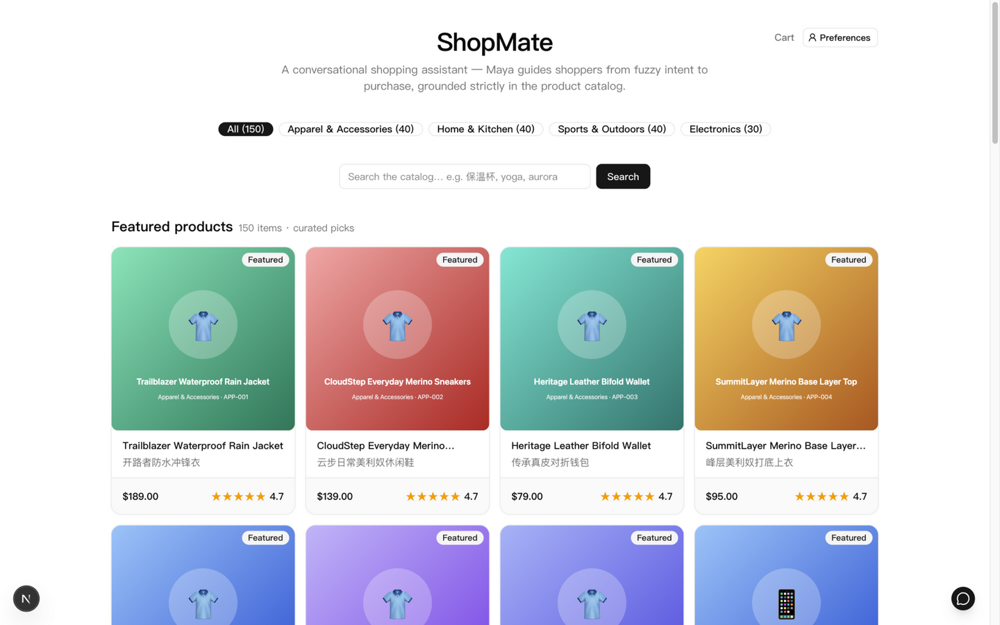
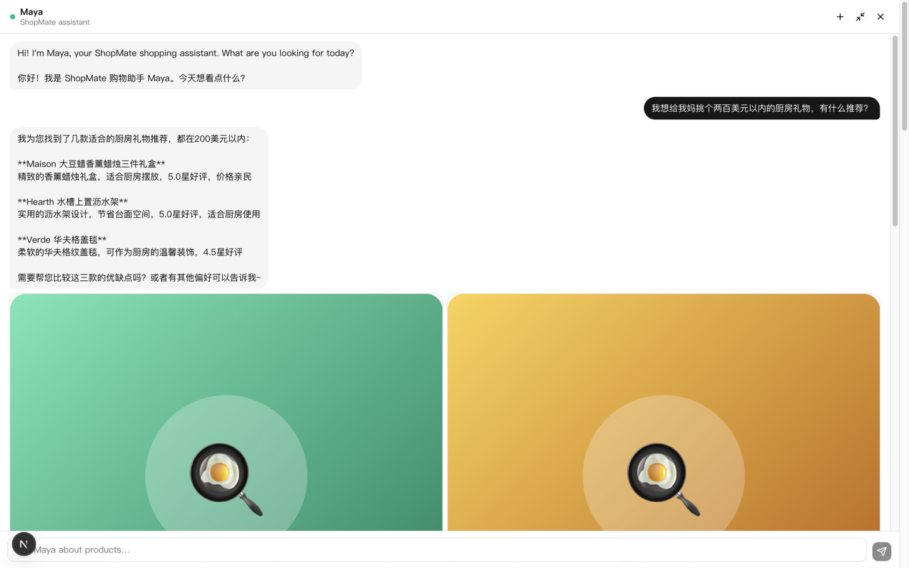
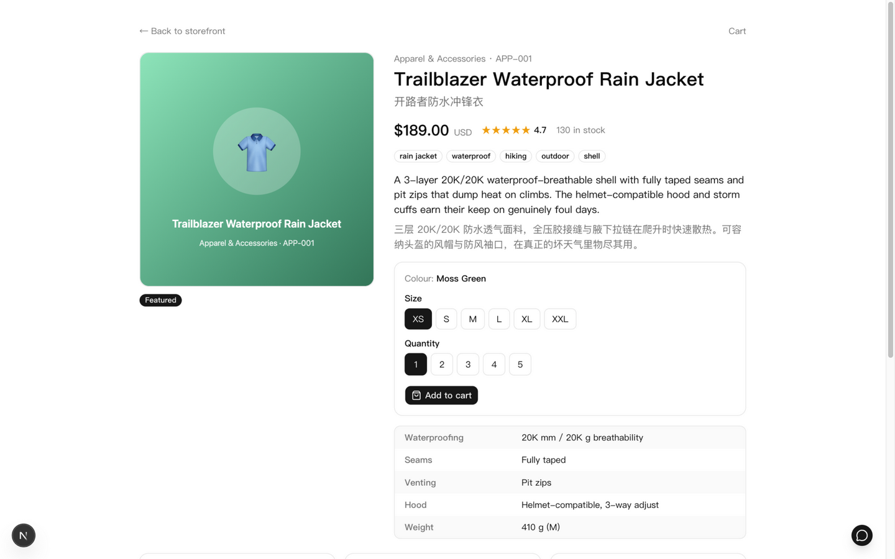
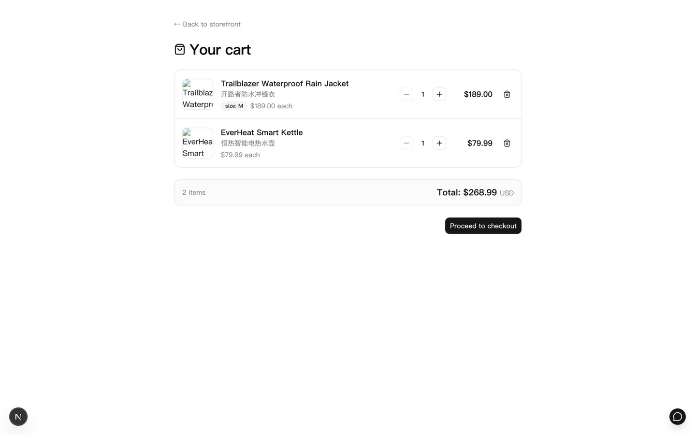
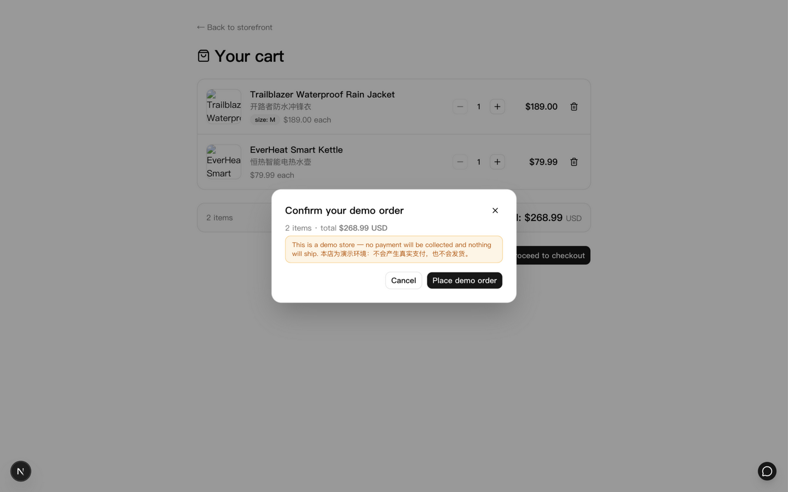
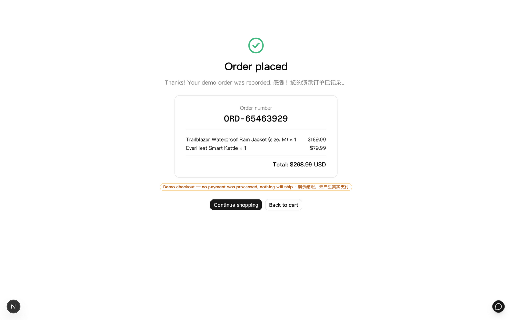
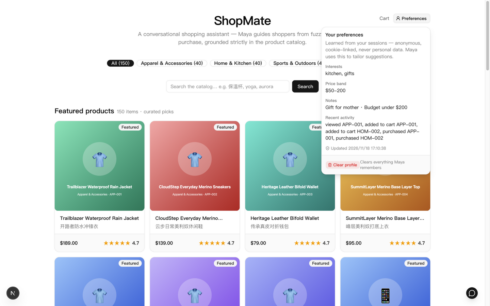

# ShopMate 🛍️

> A conversational shopping assistant for e-commerce — Maya guides shoppers from fuzzy intent to purchase, grounded strictly in the product catalog.

**Status: v1 scope implemented; formal release gate pending.** All ten implementation tickets are closed and the evaluation harness ships with the app. The hermetic eval passes 32/32, and a live run on the local provider preset (`ollama/qwen3:8b`) is committed under `backend/evals/reports/` — grounding, format, and the LLM judge PASS; the discipline metrics FAIL, the documented local-model limitation. The **formal release gate on the default provider (GLM) is still pending**: set `LLM_API_KEY` and re-run `make eval` to produce it.

---

## What is ShopMate?

ShopMate is a chat agent embedded in a demo storefront. Ask it something vague like *"I need a gift for my mom who loves cooking"* and it will ask a couple of sharp clarifying questions, then recommend real products from the catalog — never invented ones. Ask it about a specific product and it answers from specs, materials, sizing, care instructions, and reviews. It compares candidates side by side, adds items to the cart mid-conversation, and closes the loop with a demo checkout.

The assistant core is **platform-agnostic** (all commerce data flows through adapter interfaces) and **model-provider-agnostic** (OpenAI-compatible gateway): it runs on **GLM** by default and on **Ollama local models** (`qwen3:8b`) as a first-class option. Conversation is bilingual — English and Chinese — and Maya mirrors the user's language turn by turn.

## Features (v1)

- 🧭 **Guided selling** — intent understanding, ≤ 2 clarifying questions, personalized multi-turn recommendations
- 📦 **Product introduction** — specs / materials / sizing / care / review-grounded answers
- ⚖️ **Comparison** — 2–3 products, structured comparison cards, situational recommendation
- 🛒 **Chat-native cart** — add / view / remove items in conversation; shared cart state with the storefront
- ✅ **Demo checkout** — confirmation modal → order success page; order records persisted (no real payment)
- 🧠 **Cross-session profile** — preferences extracted at session end, injected next visit; user-viewable and clearable
- 🛡️ **Catalog grounding** — post-generation validation guarantees no fabricated products or prices reach the UI
- 🌐 **Bilingual** — English / Chinese storefront data and conversation
- 📊 **Measurable** — 32-scenario golden set with rule-based gates + LLM-as-judge, runnable per provider

## Screenshots

*(Captured from the running app — local Ollama `qwen3:8b` preset.)*

| | |
|---|---|
| **Storefront** — 150-product demo catalog, bilingual, category browsing | **Guided selling in chat** — Maya clarifies, searches the catalog, and renders validated product cards with match hints |
|  |  |
| **Product detail** — bilingual copy, variant pickers, spec table | **Cart** — shared state between chat and storefront |
|  |  |
| **Demo checkout confirmation** — clearly labeled, no payment | **Order success** — persisted order with name/price snapshots |
|  |  |
| **Preferences panel** — what Maya learned, viewable and clearable anytime | |
|  | |

## Architecture at a Glance

```
Next.js storefront + chat widget
        │ REST · SSE
FastAPI  ──  LangGraph agent (Maya: chatbot ⇄ tools ⇄ validate)
        │            │                    │
        │   7 catalog/cart tools   Model gateway: GLM · OpenAI · Ollama
        │            │
        │   Hybrid retrieval (BM25 + bge-m3 vectors, RRF, in-memory)
        │
SQLite (sessions · carts · orders · profiles)   Catalog: products.json + adapter
```

## Tech Stack

| Layer | Choice |
|-------|--------|
| Frontend | Next.js (App Router) · Tailwind CSS · shadcn/ui · SSE client |
| Backend | Python 3.13 · FastAPI · LangGraph · uv |
| Models | GLM (default) · OpenAI-compatible · Ollama (`qwen3:8b` default local) |
| Retrieval | rank-bm25 + jieba · bge-m3 embeddings via Ollama · RRF fusion |
| Storage | SQLite (SQLAlchemy async / aiosqlite) · JSON catalog |
| Deployment | `make dev` · Docker Compose |

## Documentation

| Doc | Contents |
|-----|----------|
| [Product Requirements (PRD)](docs/prd.md) | Goals, journeys, functional & non-functional requirements, **v2 roadmap**, success metrics |
| [System Design](docs/system-design.md) | Architecture, agent design, tool & API contracts, retrieval, guardrails, profile pipeline, data model, deployment, 8 ADRs |
| [Evaluation Plan](docs/eval-plan.md) | Golden set taxonomy, metrics & gates, LLM-judge rubric, harness & provider comparison |

## Getting Started

```bash
# One-time setup
cd backend && uv sync && cd ..     # Python 3.13 + dependencies via uv
cd frontend && npm install && cd .. # frontend dependencies

# Development (backend :8000 · frontend :3000, concurrently)
make dev                           # or: make backend / make frontend

# Configuration
cp backend/.env.example backend/.env   # then set LLM_API_KEY (or switch provider)
```

The backend starts without any API key: `GET /api/health` reports the
configured provider as `not_configured` and the app runs its liveness duties
normally. The home page (`http://localhost:3000`) shows this health status.

```bash
# Provider presets (backend/.env)
LLM_PROVIDER=glm              # default; set LLM_API_KEY — done
LLM_PROVIDER=ollama           # local-first; no key, embeddings included

# Backend tests
cd backend && uv run pytest
```

### Demo deployment (Docker)

```bash
cp .env.example .env                # GLM mode: set LLM_API_KEY; Ollama mode: LLM_PROVIDER=ollama
make docker-up                      # docker compose up --build -d  (api :8000 · web :3000)
make docker-logs                    # structured JSON logs (one chat_turn record per turn)
make docker-down
```

The stack runs the FastAPI backend (`api`) and the built Next.js app (`web`);
runtime data persists in `./backend/data`. Ollama stays on the host and is
reached from the containers via `host.docker.internal:11434` — no config
change needed relative to `make dev`.

## Repository Layout (planned)

```
ShopMate/
├── docs/            # this design set (prd · system-design · eval-plan)
├── backend/         # FastAPI · LangGraph agent · tools · retrieval · evals
│   └── data/        # catalog/products.json (150 products) · SQLite (runtime)
└── frontend/        # Next.js storefront · chat widget · preferences panel
```

## Roadmap

v2 items are already scoped in the [PRD Roadmap](docs/prd.md#6-roadmap): order status & after-sales, human handoff, multi-agent topology, multimodal (photo/voice) search, proactive recommendations, and real-platform adapters (Shopify / custom commerce APIs).
